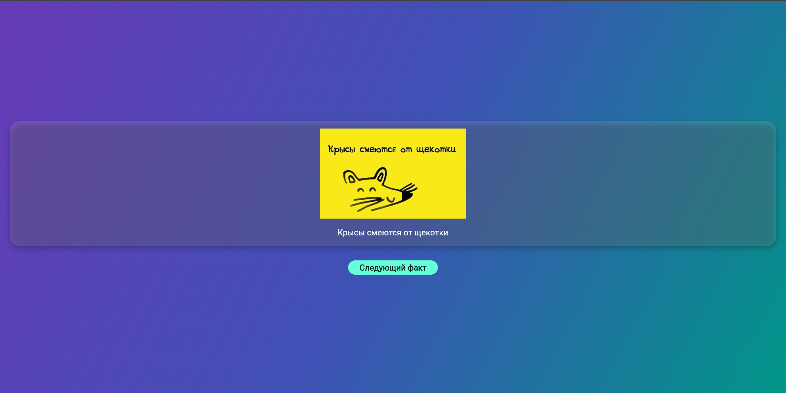

# Лабораторная работа №6. Flutter: Интерактивное приложение «Карточки с фактами»

## Описание
Приложение отображает карточку с интересным фактом, тематическим изображением и динамическим градиентным фоном.
## Автор
* **ФИО:** Алтухов Павел
* **Группа:** ИСП-241
* **Дата сдачи:** 04.11.2026

## Стек и версии
* **Flutter:** 3.35+
* **Dart:** 3.x
* **Платформа:** Web (Chrome)
* **IDE:** Visual Studio Code

## Скриншот приложения


## Структура проекта
* `lib/main.dart` — точка входа в приложение, чистый файл с отключенным DEBUG-баннером.
* `lib/facts_screen.dart` — `StatefulWidget`, управляющий случайным выбором фактов и обновлением состояния.
* `lib/gradient_background.dart` — `StatelessWidget`, создающий кастомный градиентный фон.
* `lib/fact_card.dart` — `StatelessWidget`, отвечающий за верстку изображения и текста факта.

## Как запустить
```bash
git clone [https://github.com/youngest0daughter/Flutter_Lab5_Altuhov](https://github.com/youngest0daughter/Flutter_Lab5_Altuhov)
cd facts_app_altukhov
flutter pub get
flutter run -d chrome
```
## Что изучил
* Научился строить динамический UI во Flutter.
* Освоил разделение приложения на отдельные независимые виджеты-классы и передачу данных между ними через параметры конструктора.
* Разработал модульную структуру проекта
* Настроил работу со статическими ресурсами.
* Применили класс `Random` из библиотеки `dart:math` для создания интерактивной логики и случайного выбора фактов при нажатии.
* Закрепил работу с Git и GitHub: настроили `.gitignore`.
